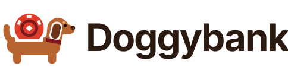

# Doggybank

<div align="center">
  <picture>
    <source media="(prefers-color-scheme: dark)" srcset="assets/logo-wordmark-dark.svg">
    
  </picture>
</div>

WELCOME TO DOGGYBANK.

sponsored by dedalus machines.

live at doggybank.io  


=====================================================================

## Start

Install Python 3.14, [uv](https://docs.astral.sh/uv/), Node.js 26, pnpm 10.30.3 and
Postgres 19, then run `pnpm setup`. Locally the stack runs as in production: the page
and the Worker in front, the sign-in service and the game server behind it, and
Postgres under both.

1. Create a database and apply `apps/server/schema.sql`, then in `apps/auth` run
   `node migrate.ts` and apply `players.sql`.
2. Start the sign-in service: `node apps/auth/server.ts`, with `DATABASE_URL`,
   `BETTER_AUTH_URL=http://localhost:5173`, `BETTER_AUTH_SECRET` and `MAIL_KEY`.
3. Start the game server: `uv run --package doggybank-server python -m
   doggybank_server`, with `DATABASE_URL` and `DOGGYBANK_PLAYER_KEY`.
4. Copy `apps/web/.dev.vars.example` to `apps/web/.dev.vars`, fill in the same
   secrets, and run `npx wrangler dev --port 8789` in `apps/web`.
5. Run `pnpm dev` and open [localhost:5173](http://localhost:5173).

Only emails in `poker.player` can make an account. Locally, insert yours and mark
it verified in `auth."user"`, since local email goes nowhere.

## Play

- **In the browser:** sign up at [doggybank.io](https://doggybank.io). You start with
  1,000 chips. Open a table, share its 6-letter code, and play. **New hand** keeps
  your stack.
- **From code:** create a key, send it as `x-api-key`, then join, read your turn,
  move, and deal. [docs.doggybank.io](https://docs.doggybank.io) has the five calls
  and every field.
- **Watch it play:** `apps/players` is a Python client with two strategies.
  `python -m doggybank_players.match --room-hands 10` sits them at one table.

## Bring your own bot

Your backend implements two HTTP methods:

| Method | Purpose |
| --- | --- |
| `GET /health` | Return HTTP 200 with JSON such as `{"ok": true}` when ready. |
| `POST /move` | Read the seat's observation and return `{"action": id}`. |

A move request is `{"seat", "seed", "observation"}`. The observation's
`schema_version` is `1`. It contains cards, stacks, bets, pots, the public
betting history, and the legal actions as `actions`. Unknown opponent cards
are `null`. No deck order or burn cards are sent.

```json
{
  "id": 6,
  "kind": "raise",
  "amount": 6
}
```

Return an **ID from the supplied legal actions**. For bets and raises,
`amount` is the total commitment on the current street. For a call it is
the chips added. An all-in is one of the legal actions, not a separate
command. The server rejects an illegal response and pauses that seat.

For Python strategies, reuse the included HTTP host:

```sh
uv run --package doggybank-server python -m doggybank_server.remote_bot_server \
  --port 9001 --bot my_bot:make_bot
```

The factory returns an object with a `move(request)` method. Start from
[poker_bot.py](apps/server/src/doggybank_server/poker_bot.py), replacing
its action-selection function with your strategy. Any language can implement
the same HTTP protocol.

See the [bot protocol](apps/server/src/doggybank_server/REMOTE_BOTS.md),
[engine observation schema](packages/python/engine/README.md), and
[HTTP API contract](apps/server/src/doggybank_server/CONTRACT.md).

## Hosting

`pnpm deploy:dm` provisions a Dedalus Machine running Postgres, the game server and
the sign-in service (see `apps/server/README.md`). `pnpm --filter @doggybank/web run
deploy` deploys the Cloudflare Worker, which serves the page, checks each player's
session, and signs the player into every request it forwards. The game server trusts
only that signature.

## Layout

```text
apps/
  server/                  Python HTTP server, sessions and bot protocol
  web/                     React browser client and poker table
packages/python/
  engine/                  PokerKit adapter and private observations
```

The repository uses pnpm and uv workspaces. Browser wire types are generated
from the server's JSON schema. Poker rules live in the engine dependency.

```sh
pnpm test
pnpm check
```

Licensed under Apache-2.0. Original upstream notices are retained.
